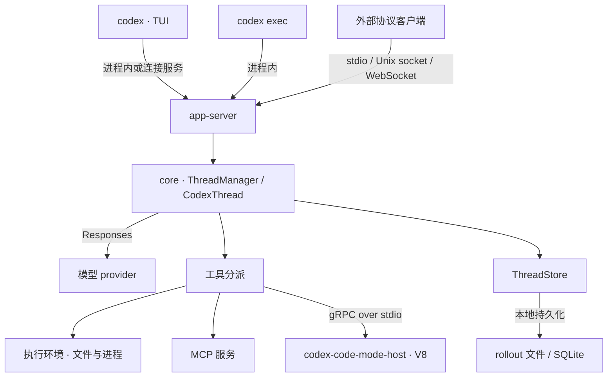

# Codex CLI 架构

`codex` 是交互界面、脚本和服务端共用的命令入口。TUI 和 `codex exec` 都通过 `app-server-client` 访问会话服务。app-server 处理会话协议，`core` 驱动模型与工具的调用循环。本地 Code Mode 通过第二个可执行文件 `codex-code-mode-host` 运行 JavaScript。[CLI 分派](../crates/cli/src/main.rs) · [workspace 默认构建目标](../Cargo.toml)

## 运行入口与进程

| 入口 | 运行方式 |
| --- | --- |
| `codex` | 启动 TUI。根据启动参数和配置，TUI 可以使用进程内 app-server、通过 Unix socket 复用或启动本地 daemon，或用 `--remote` 连接指定的服务。`codex --no-daemon` 使用进程内服务。[TUI 启动](../crates/tui/src/startup_orchestration.rs) · [客户端连接](../crates/tui/src/lib.rs) |
| `codex exec` | 在当前进程启动 app-server，提交任务，把服务端事件转成终端文本或 `--json` 事件流。[非交互入口](../crates/exec/src/lib.rs) |
| `codex app-server` | 单独运行会话服务。默认通过 stdio 提供 JSON-RPC，也可监听 Unix socket 或 WebSocket。请求、通知和服务端主动请求的名称由同一份协议定义。[监听参数](../crates/cli/src/main.rs) · [协议定义](../crates/app-server-protocol/src/protocol/common.rs) · [JSON Schema 与 TypeScript 类型](../crates/app-server-protocol/schema) |
| `codex exec-server` | 单独提供执行环境的文件和进程操作，供配置了该环境的 agent 连接。[执行服务入口](../crates/exec-server-cli/src/lib.rs) · [执行协议](../crates/exec-server-protocol/src) |

根目录运行 `cargo build --locked --release` 会在 `target/release/` 生成 `codex`（Cargo 包名 `codex-cli`）和 `codex-code-mode-host`。从源码构建后，将两者放在同一目录，core 就能按安装路径找到本地 host。[CLI 构建目标](../crates/cli/Cargo.toml) · [host 构建目标](../crates/code-mode-host/Cargo.toml) · [安装路径解析](../crates/install-context/src/lib.rs)

## 一条输入如何变成回复

1. 客户端通过 `thread/start` 创建会话线程。app-server 的线程处理器调用 `ThreadManager::start_thread`，由 core 持有活跃的 `CodexThread`。后续请求用同一个 thread ID 标识这段会话。[线程处理器](../crates/app-server/src/request_processors/thread_processor.rs) · [线程管理器](../crates/core/src/thread_manager.rs)
2. 客户端发送 `turn/start`。回合处理器调用 `CodexThread::start_or_steer_turn`。core 结合用户输入、会话历史和本回合可用的工具构造模型请求，消费流式响应。收到工具调用时，core 将调用交给工具处理器，再把结果放回上下文，继续请求模型。[回合处理器](../crates/app-server/src/request_processors/turn_processor.rs) · [回合循环](../crates/core/src/session/turn.rs) · [工具路由](../crates/core/src/tools/router.rs)
3. app-server 把回合进展发送给订阅该线程的客户端。例如，TUI 通过 `item/agentMessage/delta` 增量显示回复，通过 `turn/completed` 得知回合结束。需要用户输入的工具可以通过 `item/tool/requestUserInput` 向客户端发起请求。[协议方法与通知](../crates/app-server-protocol/src/protocol/common.rs) · [客户端事件](../crates/app-server-client/src/lib.rs)

## 配置、模型与工具

- **配置**由 `config` 分层读取并检查约束，`core::config` 将它们与启动参数合并为运行时配置。本 fork 的本地命令使用当前用户权限执行，执行审批策略固定为 `never`。功能开关由 `features` 定义，有独立设置的功能通过表内的 `enabled` 字段启用，例如 `[features.code_mode]` 下的 `enabled = true`。[配置加载](../crates/config/src/loader) · [运行时配置](../crates/core/src/config/mod.rs) · [配置项与 schema](../config.md)
- **模型推理**使用内置的 OpenAI provider，用户可配置兼容 Responses API 的 endpoint。`model-provider` 解析请求地址和鉴权，`models-manager` 管理模型目录。core 的模型客户端通过 `codex-api` 发出请求。支持 WebSocket 的 provider 可以复用连接。一旦会话切换到 HTTP 流式传输，该会话后续回合也使用 HTTP。[provider 定义](../crates/model-provider-info/src/lib.rs) · [provider 实现](../crates/model-provider/src/provider.rs) · [模型客户端](../crates/core/src/client.rs) · [Responses 端点](../crates/codex-api/src/endpoint)
- **工具**由 core 按回合组装，模型发起的调用由 core 分派。`exec_command` 在选定环境中启动命令，`write_stdin` 可继续与存活的进程交互。执行环境提供本地或远程的文件系统和进程接口。启用多 agent 时，core 注册 V2 工具，由 agent 控制层管理子线程。[工具组装](../crates/core/src/tools/spec_plan.rs) · [命令工具](../crates/core/src/tools/handlers/unified_exec.rs) · [执行环境](../crates/exec-server/src/environment.rs) · [子线程控制](../crates/core/src/agent/control)
- **Code Mode** 默认关闭。使用本地 host 时，core 按需启动 `codex-code-mode-host --listen grpc+stdio://`，多个 Code Mode 会话可共享到该子进程的连接。host 内的 `code-mode-runtime` 用 V8 执行 JavaScript 单元，单元发起的工具调用交回 core 分派。[host 生命周期](../crates/core/src/code_mode_host.rs) · [跨进程协议](../crates/code-mode-protocol) · [V8 运行时](../crates/code-mode-runtime/src) · [工具回调](../crates/core/src/tools/code_mode/delegate.rs)
- app-server 创建线程管理器时，组装**内置扩展**并为 skills、MCP、memories 等扩展传入配置和服务。MCP 扩展接入外部工具，`rmcp-client` 管理与 MCP 服务的连接。[扩展组装](../crates/app-server/src/extensions.rs) · [扩展接口](../crates/ext-extension-api/src) · [MCP 客户端](../crates/rmcp-client/src)

## 会话存储与恢复

core 通过 `ThreadStore` 按 thread ID 访问会话。默认的 `LocalThreadStore` 将 rollout 记录保存在 `CODEX_HOME`（默认 `~/.codex`）的 `sessions/` 下，已归档会话在 `archived_sessions/` 下。SQLite 保存线程元数据，以及用于分页读取回合和条目的历史索引。测试和调试也可以使用内存实现。[存储选择](../crates/core/src/thread_store_builder.rs) · [rollout 目录](../crates/rollout/src/lib.rs) · [分页历史写入 SQLite](../crates/thread-store/src/local/thread_history_materialization.rs)

`codex resume` 和 `codex exec resume` 都通过 `thread/resume` 继续会话。app-server 可将客户端重新关联到仍活跃的线程，也可从存储加载历史，由 core 重建模型上下文。终端里用来翻找以往输入的 `history.jsonl` 由 `message-history` 单独维护。[线程恢复](../crates/app-server/src/request_processors/thread_processor.rs) · [上下文重建](../crates/core/src/session/rollout_reconstruction.rs) · [输入历史](../crates/message-history/src/lib.rs)

远端执行环境有独立的 exec-server 会话 ID。连接中断后，执行客户端可以用这个 ID 重新连接，接回服务端仍保留的进程和输出。[执行连接恢复](../crates/exec-server/src/client_recovery.rs)
