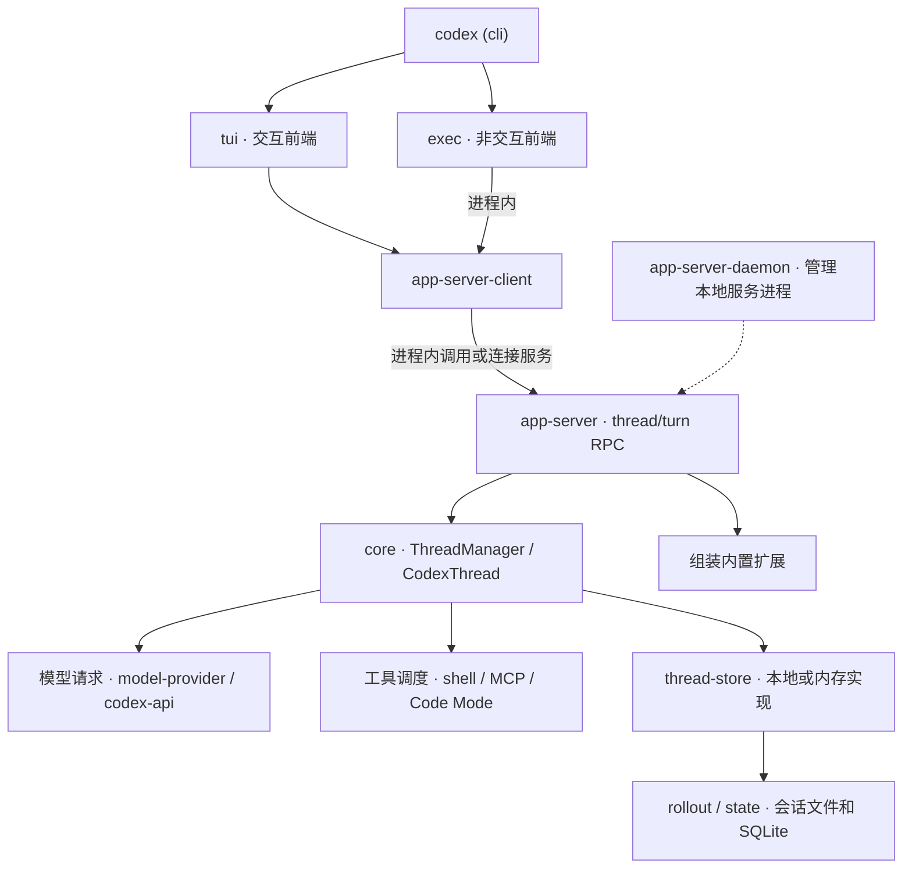

# 架构与清理计划

基线为 `tianjiao/dev` 的合并提交 `ab62b8d5f`。本 fork 的推理入口是 OpenAI API 或自定义 endpoint 加 API key。下文先描述这份源码，再列出建议改动及验收方式。

## 本轮裁剪后的边界

- 内置模型 provider 只保留 OpenAI API，自定义 provider 通过配置提供 endpoint 和 key。Bedrock、GCP 的运行时与 AWS SigV4 代理代签已经删除。Cargo 锁文件中的 `aws-lc-rs` 和 `aws-lc-sys` 由 TLS 使用。
- app-server 通过 stdio、Unix socket 或显式 WebSocket 地址提供 RPC。daemon 管理本地进程和 socket。远程控制配对、配对中继和注册记录已移除。
- 插件列表和搜索读取本地 marketplace 清单。插件仍支持本地文件、Git 和 npm 来源，显式安装或升级可以访问这些来源。ChatGPT 托管目录、分享和账号安装状态同步已经移除。

下文的依赖统计和 PR 顺序记录合并基线，供对照。

## 一次本地对话经过哪些组件



- 交互入口由 `cli` 分派给 `tui`。TUI 可以连接本地 daemon、连接显式指定的服务，或启动进程内 app-server。默认是否复用已有 daemon 取决于启动参数和 socket；本地调试 fork 可用 `cargo run -p codex-cli --bin codex -- --no-daemon` 选择进程内服务。要同时隔离配置、凭据文件和会话目录，可另设 `CODEX_HOME`。当前 `codex exec` 直接启动进程内 app-server。[CLI 分派](../crates/cli/src/main.rs) · [TUI 启动选择](../crates/tui/src/lib.rs) · [调试选项](../crates/tui/src/cli.rs) · [exec 入口](../crates/exec/src/lib.rs)
- 客户端发送 `thread/start`，app-server 的 thread processor 调用 `ThreadManager::start_thread`。随后 `turn/start` 校验输入和线程配置，调用 `CodexThread::start_or_steer_turn`。core 负责与模型交互、工具调用和线程生命周期，app-server 负责把进展送回客户端。前端与服务之间有请求、通知和服务端主动请求三种交互，审批就需要服务端向前端发起请求。[线程处理](../crates/app-server/src/request_processors/thread_processor.rs) · [回合处理](../crates/app-server/src/request_processors/turn_processor.rs) · [客户端事件](../crates/app-server-client/src/lib.rs)
- workspace 的两个 binary target 是 `codex` 和 `codex-code-mode-host`。前者运行 TUI，也提供 `exec`、`app-server` 和 `exec-server` 子命令。Code Mode 按需通过管道启动后者。[CLI 分派](../crates/cli/src/main.rs) · [Code Mode 子进程](../crates/core/src/code_mode_host.rs)

## 功能和依赖边界

| 边界 | 主要职责与实际依赖 |
| --- | --- |
| 客户端与服务端 | `app-server-protocol` 定义客户端可见的请求、结果和事件及其 schema。`protocol` 提供多个子系统共享的线程、输入和领域事件等类型。两者都有广泛的消费者，调整一次 RPC 与调整一个内部事件的影响范围不同。 |
| 会话与扩展 | `core` 持有活跃线程和回合。`app-server` 同时充当内置扩展的组装入口，注入线程管理器、状态库、事件接收器等依赖。`ext-extension-api` 定义注册接口，`ext-*` 实现相应功能。多个扩展直接使用 `core`。 |
| 配置与模型 | `config` 读取配置层及约束，`core::config` 将其组装成运行时配置。`model-provider-info` 定义 provider 配置和内置名单，`models-manager` 管理模型目录与缓存，`model-provider` 选择请求路由和鉴权，`login` 提供凭据。`codex-api` 实现 Responses 等端点和流，`codex-client` 提供传输抽象，`http-client` 构造底层 HTTP 客户端。 |
| 工具与执行 | `tools` 定义模型可见的工具描述，core 分派调用。`exec-server` 提供文件与进程执行环境，结合 `execpolicy`、`sandboxing` 等约束执行。`codex-mcp` 接入 MCP 工具和资源，`rmcp-client` 管理远端 MCP 连接。第三方 MCP OAuth 和模型 API key 有不同的凭据来源。 |
| Code Mode 与插件 | `code-mode` 负责宿主侧调用，`code-mode-protocol` 是跨进程契约，`code-mode-host` 承载依赖 V8 的 `code-mode-runtime`。`plugin-host` 管理独立 UI 插件进程的 IPC 和生命周期。`plugin` 与 `core-plugins` 则处理插件包模型与加载。裁剪精选插件同步时需要区分这几条路径。 |
| 会话与存储 | `thread-store` 提供按 ThreadId 操作的接口及本地、内存实现，core 按配置选择。持久化路径用 `rollout` 处理 JSONL 会话记录，`state` 存 SQLite 元数据及其他本地状态。`history` 定义模型历史和持久化领域类型，`message-history` 管理全局输入历史，`attachment-store` 负责附件。会话恢复、输入历史和普通音频附件需要分别验证。 |

实现入口见 [扩展组装](../crates/app-server/src/extensions.rs)、[模型 provider](../crates/model-provider/src/provider.rs)、[请求端点](../crates/codex-api/src/lib.rs)、[Code Mode runtime](../crates/code-mode-runtime/Cargo.toml)、[线程存储构造](../crates/core/src/thread_store_builder.rs) 和 [输入历史](../crates/message-history/src/lib.rs)。

## 目前最值得改的关系

1. **配置入口已经收紧，运行时仍带着云 provider。** 内置表只有 OpenAI，自定义 provider 合并时会拒绝 Bedrock、GCP 以及若干账号认证字段。运行时工厂仍能构造 Bedrock/GCP，`model-provider` 和 `app-server` 的清单仍直接依赖 `aws-auth`，`login` 仍使用 `workload-identity` 的类型。这是按产品范围可以先消掉的一组依赖。[配置校验](../crates/model-provider-info/src/lib.rs) · [运行时选择](../crates/model-provider/src/provider.rs) · [凭据管理](../crates/login/src/auth/manager.rs)
2. **账号功能还出现在命令和协议表面。** app-server 仍能解析 ChatGPT 登录请求，再返回 unsupported。`chatgpt` 中的 `codex apply` 读取云任务的 diff，本地模型工具 `apply-patch` 是另一条调用链。`backend-client` 既提供账号 profile 和 analytics，又承担 API key 的 turn cost 查询。删除整个包会同时影响后者。[账号 RPC](../crates/app-server/src/request_processors/account_processor.rs) · [云任务 diff](../crates/chatgpt/src/apply_command.rs) · [费用查询](../crates/app-server/src/turn_cost_worker.rs)
3. **前端仍经客户端库拿到服务端内部类型。** `tui` 的 Cargo 清单里没有直接的 `core` 依赖，但 TUI 通过 `app-server-client::legacy_core` 使用 `core::config::ConfigBuilder` 等实现。客户端库还直接构造进程内服务。只改清单无法形成客户端边界。[TUI 引用](../crates/tui/src/lib.rs) · [客户端导出](../crates/app-server-client/src/lib.rs)
4. **单看依赖数量无法决定该拆谁。** 146 个 workspace 成员中，`core` 直接依赖 69 个成员，`app-server` 依赖 62 个，`cli` 依赖 47 个，`tui` 依赖 46 个。`protocol` 有 77 个直接消费者。这里统计各目标平台及 feature 的清单声明，每对包只计一次，排除外部依赖、build 和 dev 依赖。应先清掉已退出的功能，再看哪些依赖仍跨过了职责边界。[workspace 清单](../Cargo.toml)

## 建议的 PR 顺序

| 顺序 | 改动范围 | 验收 |
| --- | --- | --- |
| 1. 收尾推理 provider | 先删除 Bedrock/GCP 工厂分支、签名与专属运行时，实现清理后移除直接依赖。清点 `login` 的 workload-identity 数据流，把仅服务该分支的残留另作小提交。沿现有配置解析路径，让已删除 provider 的配置仍明确报错。 | 用本地 mock Responses endpoint 各跑一次 OpenAI base URL 覆盖和自定义 provider，会话收到流式回复；覆盖环境变量取 key 和已有 API key 存储。用 Cargo 反向依赖检查 `aws-auth` 的生产调用方，同时确认自定义 endpoint 收到预期的认证头。 |
| 2. 逐端点收尾账号功能 | 从账号专属 CLI/TUI 操作和 app-server 请求向下删除处理器与类型，同步生成 schema 和客户端。先列出 `backend-client` 的账号专属调用和 API key 费用调用；把仍需要的费用接口与账号功能分开。把仅属于云任务的命令与本地补丁工具分别验证。 | CLI help、TUI 操作和导出的协议都只展示实际支持的登录方式。用干净的临时配置和 mock，在 TUI 首次打开至空闲期间记录网络目的地，验证已移除的公告、精选插件同步、ChatGPT 模型目录和账号请求均未发出。提交首个回合后验证 API key 的模型调用及费用路径。 |
| 3. 理顺前端启动边界 | 从一个实际泄漏开始，将 TUI 用到的本地偏好与服务端运行配置分开。先用已有配置 RPC 承载服务端字段，把进程内启动构造集中起来，逐个移除 `legacy_core` 引用。显式远端、共享 daemon 与进程内三条路径分别覆盖。 | 使用同一个 mock 跑 TUI 与 `codex exec`。显式远端请求抵达指定服务，`--no-daemon` 在已有 daemon 的环境中仍只使用进程内服务。迁移完成的 TUI 模块直接依赖前端或协议类型。 |
| 4. 用一个扩展检验 core 的边界 | 对 `ext-*` 逐个追踪注册处、运行时依赖和回调。选择一个直接依赖 core、实际只消费少数操作的扩展，优先复用已有注册接口，将实现细节留在宿主。用结果判断下一个扩展是否适合同样的做法。 | 注册、工具或事件回调、取消与关闭按该扩展的现有行为通过测试。Cargo 图中减少对应的直接依赖。 |

Code Mode host 由运行时作为子进程启动，在 Rust 依赖图之外使用。

## Workspace 目录索引

下表按主要职责列出基线的全部成员。名称使用 `crates/` 下的目录名，部分与 Cargo 包名不同，例如 `ext-extension-api` 对应 `codex-extension-api`。

| 职责 | 目录 |
| --- | --- |
| 入口与终端 | `cli`、`tui`、`exec`、`arg0`、`ansi-escape`、`terminal-detection`、`mermaid`、`utils-cli` |
| 应用服务与 RPC | `app-server`、`app-server-client`、`app-server-daemon`、`app-server-protocol`、`app-server-protocol-noop-macros`、`app-server-transport`、`codex-experimental-api-macros` |
| 会话与公共数据类型 | `core`、`protocol`、`context-fragments`、`prompts`、`tools`、`collaboration-mode-templates`、`agent-roles` |
| 配置与安装环境 | `config`、`features`、`codex-home`、`install-context`、`build-info` |
| 推理与 HTTP | `model-provider-info`、`model-provider`、`models-manager`、`codex-api`、`codex-client`、`http-client`、`responses-api-proxy`、`websocket-client`、`response-debug-context` |
| 凭据、托管身份与后端 | `login`、`keyring-store`、`secrets`、`aws-auth`、`workload-identity`、`agent-identity`、`runtime-agent-instance`、`user-verification`、`websocket-auth`、`chatgpt`、`backend-client`、`codex-backend-openapi-models`、`connectors` |
| 工具执行、文件与沙箱 | `exec-server`、`exec-server-cli`、`exec-server-protocol`、`sandboxing`、`execpolicy`、`network-proxy`、`shell-command`、`apply-patch`、`file-search`、`file-system`、`file-watcher`、`git-utils`、`worktree`、`uds`、`stdio-to-uds`、`tcp-tunnel` |
| Code Mode 与 UI 插件进程 | `code-mode`、`code-mode-protocol`、`code-mode-host`、`code-mode-runtime`、`plugin-host` |
| 会话存储与历史 | `thread-store`、`rollout`、`state`、`history`、`message-history`、`attachment-store`、`agent-graph-store`、`external-agent-migration` |
| 内置扩展 | `ext-extension-api`、`ext-agent`、`ext-agent-message-board`、`ext-connectors`、`ext-git-attribution`、`ext-goal`、`ext-guardian-reviewer`、`ext-guardian-v2`、`ext-guardian-v3`、`ext-history-notes`、`ext-image-generation`、`ext-items`、`ext-mcp`、`ext-memories`、`ext-multi-env-copy-file`、`ext-queue`、`ext-skills`、`ext-web-search` |
| 插件、外部工具与扩展的支撑库 | `plugin`、`core-plugin-common`、`core-plugins`、`hooks`、`skills`、`codex-mcp`、`rmcp-client`、`memories-read`、`memories-write`、`guardian-context`、`message-board`、`message-board-mcp`、`agent-message-board-client`、`agent-message-board-host` |
| 诊断与遥测 | `diagnostics`、`direct-tool-timing`、`feedback`、`otel`、`otel-trace-websocket`、`rollout-trace` |
| 测试、示例和实验 | `app-server-test-client`、`app-server-test-support`、`core-test-support`、`exec-server-test-support`、`protocol-test-support`、`test-binary-support` |
| 通用小库 | `async-utils`、`utils-absolute-path`、`utils-approval-presets`、`utils-audio`、`utils-cache`、`utils-cargo-bin`、`utils-critical-path`、`utils-elapsed`、`utils-fuzzy-match`、`utils-git-discovery`、`utils-head-tail-buffer`、`utils-home-dir`、`utils-image`、`utils-json-to-toml`、`utils-model-facing-id`、`utils-output-truncation`、`utils-path-uri`、`utils-path-utils`、`utils-plugins`、`utils-process`、`utils-pty`、`utils-readiness`、`utils-redacted-string`、`utils-rustls-provider`、`utils-sandbox-summary`、`utils-sleep-inhibitor`、`utils-stream-parser`、`utils-string`、`utils-template` |

可在仓库根目录复核成员及当前平台的依赖链。

```sh
cargo metadata --locked --offline --no-deps --format-version 1
cargo tree --locked -p codex-cli -e normal --depth 1
cargo tree --locked --workspace -e normal -i codex-aws-auth
```
